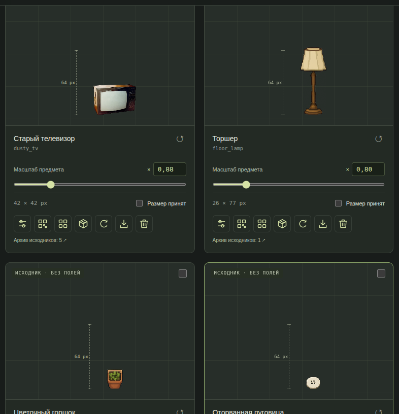
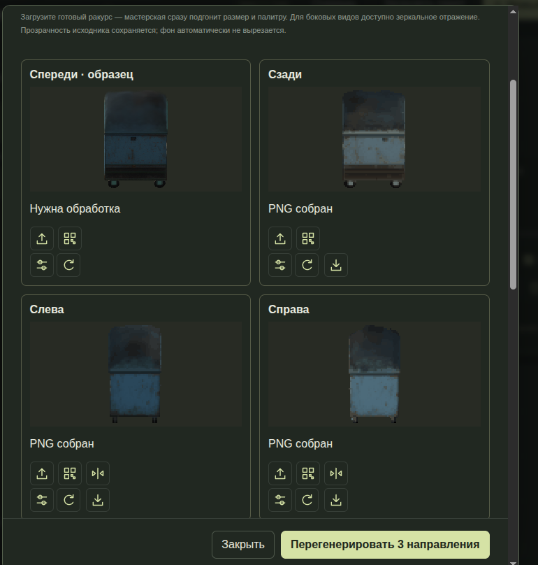
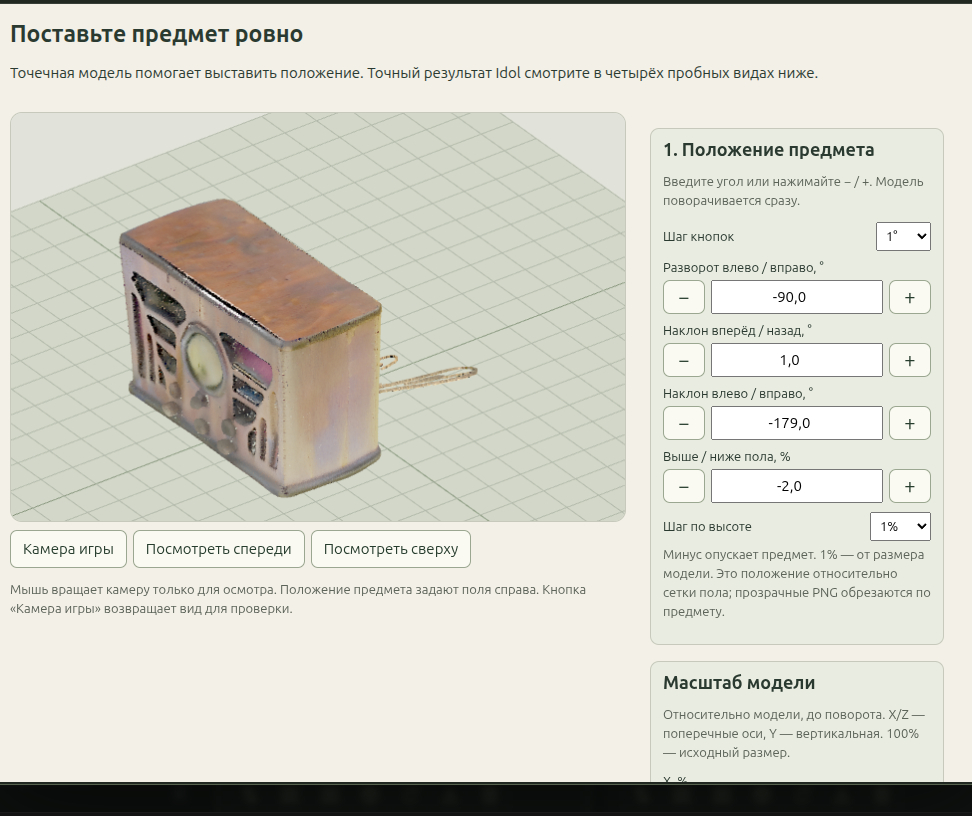
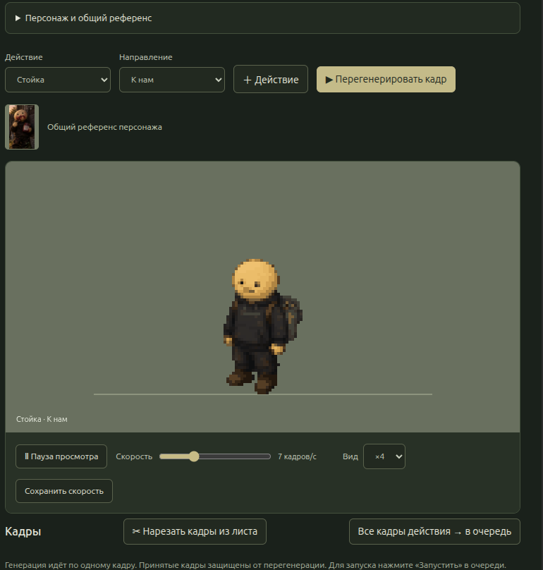

# Sprite Workshop

English | [Русский](README.ru.md)

A local workshop for creating game objects and character animations, from a generated source image to a finished pixel-art PNG. Build a collection, adjust scale, create multiple views, and export the results for your game.

## Features

- Generate and edit images through local ComfyUI and Qwen-Image 2.1 Turbo, including reference-based workflows.
- Queue individual or batch jobs, keep source and version history, and check transparency.
- Adjust dimensions, scale, and palette; pixelate and export PNG files.
- Create four views of an object: generate them, upload them manually, or mirror a side view.
- Build a 3D model with IDOL, orient it, and apply rendered views.
- Create character animations with actions and directions, frame editing, sprite-sheet slicing, previews, and export.
- Search locally by meaning and prepare files for Tiled.

### Collection and scale



### Four views



### 3D model orientation



### Character animation



## Quick start

The interface and image processing require Python 3.10 or newer and Pillow. From the project root:

```bash
python3 -m venv .venv
source .venv/bin/activate
python -m pip install Pillow
./start.sh
```

Open the [workshop](http://127.0.0.1:8767/). The server listens on localhost only. To use a separate collection and port:

```bash
./start.sh --workspace /path/to/collection --port 8768
```

Use the language selector in the header to switch between Russian and English. Object names, prompts, and project data keep their original language.

Image generation additionally requires a running ComfyUI instance. 3D reconstruction and semantic search require separate models and environments, described below. The interface and processing of existing images remain available without them.

## Image generation

Run ComfyUI at `127.0.0.1:8188` using a version that supports Qwen-Image 2.1 Turbo. The current workshop graph expects the following model files in the corresponding ComfyUI directories:

- diffusion model: `qwen_image_2.1_turbo_int8_convrot.safetensors`;
- text encoder: `qwen3vl_8b_int8_convrot.safetensors`;
- VAE: `qwen_image_2.1_vae_bf16.safetensors`.

File names and nodes are defined in [`app/sprite_tools/adapters/qwen.py`](app/sprite_tools/adapters/qwen.py). For model information and ComfyUI installation, see [Qwen-Image 2.1 Turbo](https://huggingface.co/Qwen/Qwen-Image-2.1-Turbo) and [ComfyUI](https://github.com/Comfy-Org/ComfyUI).

Add an object or a batch of jobs, then start the queue. An example batch is available in [`examples/prompts.json`](examples/prompts.json). Jobs run sequentially. If a result is uncertain, the queue stops and asks you to check it instead of automatically resubmitting it.

## IDOL: 3D and views

For 3D reconstruction, the workshop uses a local installation of [IDOL](https://github.com/speridlabs/idol-sdk), the original [DINOv3 ViT-H+/16](https://huggingface.co/facebook/dinov3-vith16plus-pretrain-lvd1689m), and the VAE from [FLUX.2-dev](https://huggingface.co/black-forest-labs/FLUX.2-dev). Access to DINOv3 and FLUX.2-dev on Hugging Face may require approval. A compatible NVIDIA GPU and a Python environment with PyTorch/CUDA are required; reconstruction can take several minutes.

These components currently need to be installed **manually**. The workshop expects the model directory in this layout:

```text
models/idol/
├── source/idol/                  # idol-sdk source code
├── weights/                      # config.json and IDOL weights, including BiRefNet
├── flux2/vae/                    # FLUX.2 VAE configuration and weights
└── experiments/dinov3-original/  # DINOv3 config.json and model.safetensors
```

If the model directory is outside the project or you use a separate environment, create a local `idol-runtime.json` file in the workshop root:

```json
{
  "root": "/path/to/models/idol",
  "python": "/path/to/idol-environment/bin/python"
}
```

The `python` field is optional; without it, the workshop uses `runtime/bin/python` inside the IDOL directory. The environment needs PyTorch, Transformers, Diffusers, TensorDict, NumPy, Pillow, safetensors, plyfile, trimesh, SciPy, and ModernGL. See the [IDOL SDK](https://github.com/speridlabs/idol-sdk) for the models and their dependencies. The workshop does not yet provide an automatic IDOL installer.

In the four-view dialog, build a model, adjust its orientation if needed, and apply the views you want. The result is saved as a Gaussian splat in PLY format; the orientation dialog shows a simplified point-cloud preview. The opacity threshold can remove faint transparent-background noise before a new reconstruction.

## Animation

Open the character animation section, create a project, and add a reference. You can generate individual frames or actions, adjust their position and scale, preview motion, and slice frames from a sprite sheet. Exports include PNG files, a sprite sheet, and a JSON file with animation settings.

## Semantic search

Local semantic search uses a separate CPU environment and the `google/embeddinggemma-2` model. Install them explicitly:

```bash
./setup-search.sh
```

Downloading the model may require access to its Hugging Face page and authentication. The installed model and environment remain local.

## Data

By default, the workshop stores its data in `workspace/`:

- `raw/` — source images and object settings;
- `output/` — generated PNGs and their versions;
- `history/` — previous source images;
- `queue/` and `runtime/` — the job queue and generation results;
- `animations/` — animation projects, versions, and exports;
- `reconstruction/` — 3D models and views;
- `references/` — uploaded references.

This directory is excluded from Git. Back it up in full: exported settings do not include images.

## Tests

```bash
python3 -m unittest discover -s app -p 'test_*.py'
node --test app/test_*.cjs
```

The tests use temporary data and do not run actual neural-network generation.

## Licenses and external models

The workshop's own code is distributed under the [MIT License](LICENSE). The bundled three.js library has its [own MIT license](app/vendor/three/LICENSE). External software and model weights are installed separately and are not included or relicensed by this repository:

- **IDOL:** the [model](https://huggingface.co/speridlabs/idol) and [IDOL SDK](https://github.com/speridlabs/idol-sdk) are distributed under Apache-2.0.
- **DINOv3 ViT-H+:** Meta's [DINOv3 license](https://huggingface.co/facebook/dinov3-vith16plus-pretrain-lvd1689m/blob/main/LICENSE.md) governs use and redistribution. Access to the [weights](https://huggingface.co/facebook/dinov3-vith16plus-pretrain-lvd1689m) requires approval.
- **FLUX.2-dev:** the [model repository](https://huggingface.co/black-forest-labs/FLUX.2-dev) is subject to the [FLUX Non-Commercial License](https://huggingface.co/black-forest-labs/FLUX.2-dev/blob/main/LICENSE.md), which restricts use to non-commercial, non-production purposes. The workshop uses only its VAE; check the terms and any separate license applicable to the exact VAE files and version. Access is gated.
- **Qwen-Image 2.1 Turbo:** the [Qwen Research License](https://huggingface.co/Qwen/Qwen-Image-2.1-Turbo/blob/main/LICENSE) permits model use for non-commercial research and evaluation; commercial use requires a separate license. The workshop uses converted files available from [Comfy-Org](https://huggingface.co/Comfy-Org/Qwen-Image-2.1); check the terms of the exact files you install.
- **ComfyUI and semantic search:** [ComfyUI](https://github.com/Comfy-Org/ComfyUI) and the optional [EmbeddingGemma model](https://huggingface.co/google/embeddinggemma-2) have their own licenses and terms.
