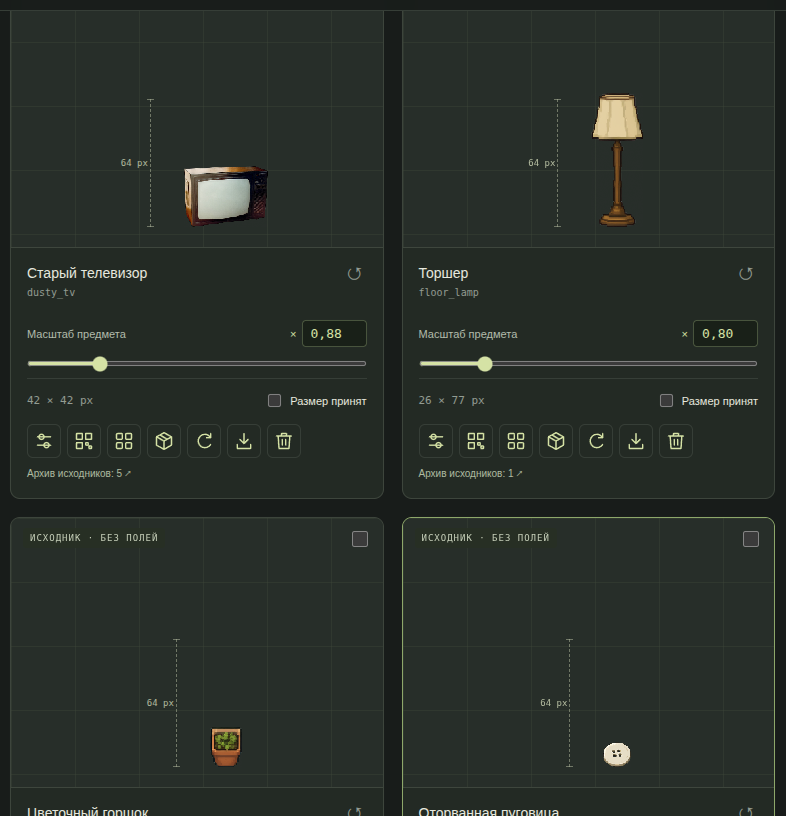
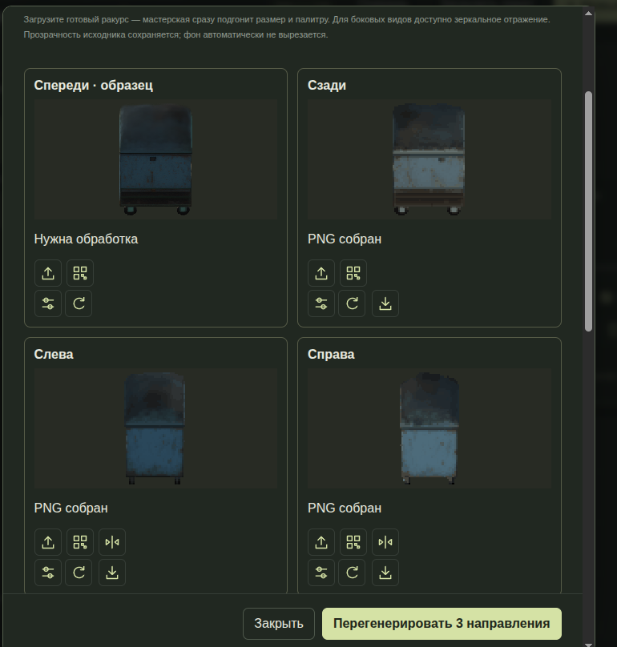
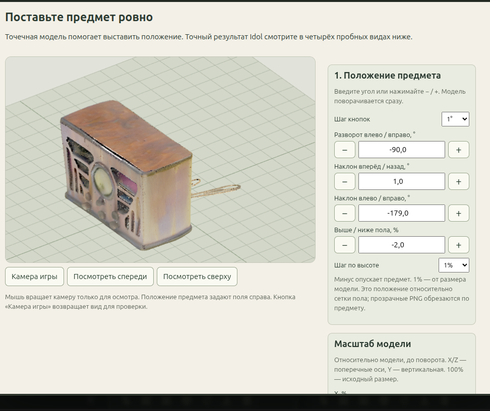
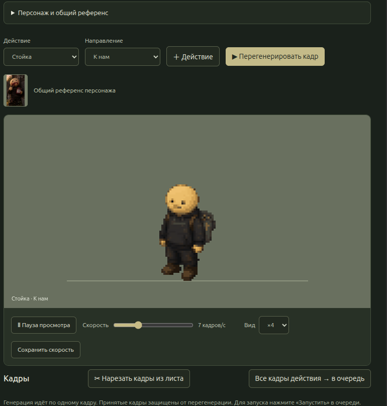

# Мастерская спрайтов

[English](README.md) | Русский

Локальная мастерская для создания игровых предметов и анимаций: от генерации исходного изображения до готового пиксельного PNG. Можно собрать коллекцию, настроить масштаб, получить несколько ракурсов и экспортировать результаты для игры.

## Возможности

- Генерация и редактирование изображений через локальный ComfyUI и Qwen-Image 2.1 Turbo, в том числе по референсу.
- Очередь одиночных и пакетных заданий, история исходников и версий, проверка прозрачности.
- Настройка размеров, масштаба и палитры; пикселизация и экспорт PNG.
- Четыре ракурса предмета: генерация, ручная загрузка и отражение бокового вида.
- Построение 3D-модели через IDOL, настройка её положения и применение ракурсов.
- Анимации персонажей: действия и направления, покадровая редактура, нарезка листа, предпросмотр и экспорт спрайт-листа.
- Локальный поиск по смыслу и подготовка файлов для Tiled.

### Коллекция и масштаб



### Четыре ракурса



### Ориентация 3D-модели



### Анимация персонажа



## Быстрый запуск

Для интерфейса и обработки изображений нужны Python 3.10 или новее и Pillow. Из корня проекта:

```bash
python3 -m venv .venv
source .venv/bin/activate
python -m pip install Pillow
./start.sh
```

Откройте [мастерскую](http://127.0.0.1:8767/). Сервер слушает только локальный адрес. Для отдельной коллекции и другого порта:

```bash
./start.sh --workspace /путь/к/коллекции --port 8768
```

Переключатель в верхней части страницы меняет язык интерфейса между русским и английским. Названия предметов, промпты и данные проектов сохраняются на исходном языке.

Для генерации изображений отдельно нужен работающий ComfyUI; для 3D и смыслового поиска — дополнительные модели и окружения, описанные ниже. Без них интерфейс и работа с уже имеющимися изображениями остаются доступны.

## Генерация изображений

Запустите ComfyUI на `127.0.0.1:8188` и установите поддерживающую Qwen-Image 2.1 Turbo версию ComfyUI. Текущий граф мастерской ожидает следующие файлы моделей в соответствующих папках ComfyUI:

- диффузионную модель `qwen_image_2.1_turbo_int8_convrot.safetensors`;
- текстовый энкодер `qwen3vl_8b_int8_convrot.safetensors`;
- VAE `qwen_image_2.1_vae_bf16.safetensors`.

Названия файлов и используемые узлы заданы в [`app/sprite_tools/adapters/qwen.py`](app/sprite_tools/adapters/qwen.py). Информацию о модели и установке ComfyUI смотрите на страницах [Qwen-Image 2.1 Turbo](https://huggingface.co/Qwen/Qwen-Image-2.1-Turbo) и [ComfyUI](https://github.com/Comfy-Org/ComfyUI).

Добавьте предмет или пакет заданий, затем запустите очередь. Пример пакета — в [`examples/prompts.json`](examples/prompts.json). Очередь выполняет задания последовательно; при неопределённом результате она останавливается и предлагает проверить результат, не отправляя его повторно автоматически.

## IDOL: 3D и ракурсы

Для 3D мастерская использует локально установленный [IDOL](https://github.com/speridlabs/idol-sdk), оригинальную [DINOv3 ViT-H+/16](https://huggingface.co/facebook/dinov3-vith16plus-pretrain-lvd1689m) и VAE из [FLUX.2-dev](https://huggingface.co/black-forest-labs/FLUX.2-dev). Для DINOv3 и FLUX.2-dev может потребоваться одобрение доступа на Hugging Face. Нужны совместимая видеокарта NVIDIA и окружение Python с PyTorch/CUDA; построение может занимать несколько минут.

Установка этих компонентов пока выполняется **вручную**. Мастерская ожидает каталог модели следующей структуры:

```text
models/idol/
├── source/idol/                  # исходный код idol-sdk
├── weights/                      # config.json и веса IDOL, включая BiRefNet
├── flux2/vae/                    # конфигурация и веса VAE FLUX.2
└── experiments/dinov3-original/  # config.json и model.safetensors DINOv3
```

Если каталог расположен вне проекта или используется отдельное окружение, создайте в корне мастерской локальный файл `idol-runtime.json`:

```json
{
  "root": "/путь/к/models/idol",
  "python": "/путь/к/окружению-idol/bin/python"
}
```

Поле `python` необязательно: без него используется `runtime/bin/python` внутри каталога IDOL. В окружении нужны PyTorch, Transformers, Diffusers, TensorDict, NumPy, Pillow, safetensors, plyfile, trimesh, SciPy и ModernGL. Инструкции по самим моделям и их зависимости приведены в [SDK IDOL](https://github.com/speridlabs/idol-sdk). Автоматического установщика IDOL в мастерской пока нет.

В окне «Ракурсы · 4» постройте модель, при необходимости настройте её ориентацию и примените выбранные ракурсы. Результат сохраняется как Gaussian splat в PLY; окно ориентации показывает упрощённый точечный предпросмотр. Порог непрозрачности помогает убрать слабый шум прозрачного фона перед новым построением.

## Анимации

Откройте раздел «Анимации персонажей», создайте проект и добавьте референс. Можно генерировать отдельные кадры или действия, менять их положение и масштаб, проверять движение и нарезать кадры из общего листа. Экспорт содержит PNG, спрайт-лист и JSON с настройками анимации.

## Поиск по смыслу

Для локального смыслового поиска предусмотрено отдельное CPU-окружение и модель `google/embeddinggemma-2`. Их установка запускается явно:

```bash
./setup-search.sh
```

Для скачивания модели может понадобиться доступ к её странице и авторизация Hugging Face. Установленные модель и окружение остаются локальными.

## Данные

По умолчанию мастерская сохраняет данные в `workspace/`:

- `raw/` — исходники и настройки предметов;
- `output/` — собранные PNG и их версии;
- `history/` — предыдущие исходники;
- `queue/` и `runtime/` — очередь и результаты генерации;
- `animations/` — проекты анимаций, версии и экспорт;
- `reconstruction/` — 3D-модели и ракурсы;
- `references/` — загруженные референсы.

Эта папка не входит в Git. Для резервной копии сохраните её целиком: выгрузка настроек не содержит изображений.

## Проверки

```bash
python3 -m unittest discover -s app -p 'test_*.py'
node --test app/test_*.cjs
```

Тесты работают на временных данных и не запускают реальную генерацию нейросетями.

## Лицензии и внешние модели

Собственный код мастерской распространяется по [MIT License](LICENSE). Включённая библиотека three.js имеет [собственную лицензию MIT](app/vendor/three/LICENSE). Внешние программы и веса моделей устанавливаются отдельно, не входят в репозиторий и не получают его лицензию:

- **IDOL:** [модель](https://huggingface.co/speridlabs/idol) и [IDOL SDK](https://github.com/speridlabs/idol-sdk) распространяются по Apache-2.0.
- **DINOv3 ViT-H+:** использование и распространение регулируются [лицензией DINOv3 от Meta](https://huggingface.co/facebook/dinov3-vith16plus-pretrain-lvd1689m/blob/main/LICENSE.md). Доступ к [весам](https://huggingface.co/facebook/dinov3-vith16plus-pretrain-lvd1689m) предоставляется после одобрения заявки.
- **FLUX.2-dev:** [репозиторий модели](https://huggingface.co/black-forest-labs/FLUX.2-dev) распространяется по [FLUX Non-Commercial License](https://huggingface.co/black-forest-labs/FLUX.2-dev/blob/main/LICENSE.md), ограничивающей использование некоммерческими целями вне производственной эксплуатации. Мастерская использует только VAE; проверьте условия и возможную отдельную лицензию конкретных файлов VAE и их версии. Доступ ограничен.
- **Qwen-Image 2.1 Turbo:** [Qwen Research License](https://huggingface.co/Qwen/Qwen-Image-2.1-Turbo/blob/main/LICENSE) разрешает использовать модель для некоммерческих исследований и оценки; для коммерческого использования нужна отдельная лицензия. Мастерская использует преобразованные файлы, доступные у [Comfy-Org](https://huggingface.co/Comfy-Org/Qwen-Image-2.1); проверьте условия конкретных устанавливаемых файлов.
- **ComfyUI и семантический поиск:** [ComfyUI](https://github.com/Comfy-Org/ComfyUI) и необязательная [модель EmbeddingGemma](https://huggingface.co/google/embeddinggemma-2) имеют собственные лицензии и условия.
